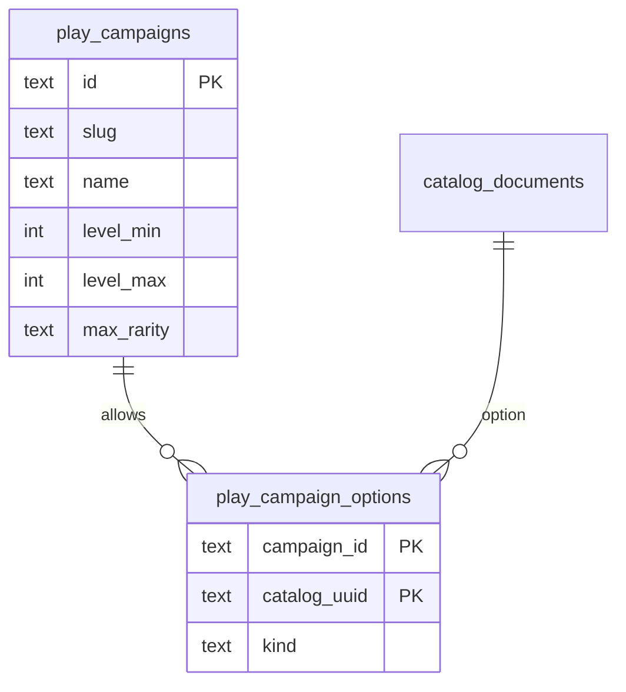

# Campaign settings

A campaign is the allow-list for the character generator. It starts empty. Nothing in the catalog is offered until this file names it.

The catalog (`catalog_*`) is the game. A campaign (`play_campaigns`, `play_campaign_options`) is one table's choices. Re-importing `.data` does not edit the campaign file. Rebuilding a pack deletes option rows whose catalog document disappeared. Run setup again after a catalog import.

The character generator loads these tables in `src/routes/(private)/char-gen/+page.server.ts`. With one campaign in the database, that campaign is the table. With several, open `/char-gen?campaign=<slug>`. Options and `max_rarity` filter ancestries, heritages, backgrounds, classes, and 1st-level feats. An empty option list offers nothing of that kind.

## What a campaign stores

| Column                   | Meaning                                                           |
| ------------------------ | ----------------------------------------------------------------- |
| `slug`                   | Stable id used by the setup command, unique                       |
| `name`                   | Label shown to players                                            |
| `level_min`, `level_max` | Character levels this table allows, 1–20, min ≤ max               |
| `max_rarity`             | Highest rarity offered: `common`, `uncommon`, `rare`, or `unique` |
| `sources`                | Publication titles for feats. Empty means every book              |

Each allowed ancestry, heritage, background, or class is one row in `play_campaign_options`:

| Column         | Meaning                                                            |
| -------------- | ------------------------------------------------------------------ |
| `kind`         | `ancestry`, `heritage`, `background`, or `class`                   |
| `catalog_uuid` | `catalog_documents.uuid` for a player-facing document of that type |

An empty option list means the generator offers nothing of that kind. That is a new campaign, not an error.



## File

One JSON file per campaign, under `campaigns/`. Slugs are catalog `slug` values, the same strings the current TypeScript config uses. The setup command resolves each slug to a remaster player-facing document.

```json
{
	"slug": "thursday",
	"name": "Thursday table",
	"levelMin": 1,
	"levelMax": 10,
	"maxRarity": "common",
	"ancestries": ["human", "elf"],
	"heritages": ["versatile-human"],
	"backgrounds": ["warrior"],
	"classes": ["fighter"]
}
```

Omit a list, or leave it `[]`, to allow nothing of that kind. `levelMin` defaults to 1, `levelMax` to 20, `maxRarity` to `common`.

`campaigns/example.json` is a one-of-each campaign you can copy.

## Setup

Apply the campaign migration once, after the catalog migration:

```bash
npm run migrate
```

Create or replace a campaign from its file. This needs the matching catalog packs (`ancestries`, `heritages`, `backgrounds`, `classes`) to already be imported.

```bash
npm run campaign:setup -- campaigns/example.json
```

The command upserts the campaign by `slug`, deletes its previous options, and inserts the resolved uuids. A slug that is not in the catalog is printed and the command exits with an error, leaving the campaign row in place and its options unchanged only when every slug resolved. If any slug is missing, no option rows are written.

Copy `campaigns/example.json` to something like `campaigns/thursday.json`, edit the lists, and run the command again. That is the whole setup.
